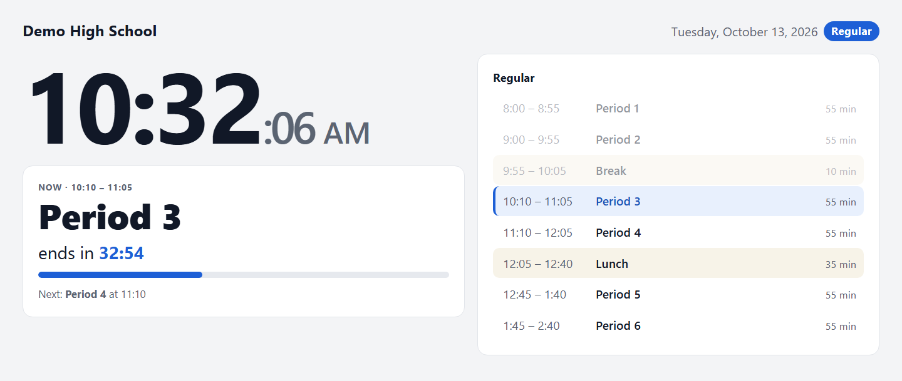
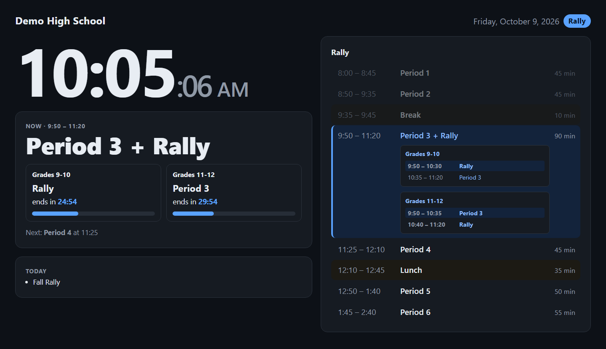

# Bell Schedule

[](https://github.com/HasibZiai/bell-schedule-template/actions/workflows/ci.yml)

A hallway / classroom display showing the current time, the current period with a countdown, and today's
bell schedule. One deployment serves any number of schools; each school keeps its schedule in a
**Google Sheet** made from a template. Built with Astro and deployed to Cloudflare Workers.





## Pages

| URL | What it is |
|---|---|
| `/` | List of schools (or straight to the school, if there's only one). |
| `/<school>` | The display. |
| `/<school>/preview` | Every upcoming day and the schedule it resolves to, plus anything to fix in the sheet. `?all` shows the whole year. |
| `/api/<school>/today` | JSON for today (or `?date=YYYY-MM-DD`). |

Display options (combine with `&`):

- `?kiosk`: hide controls and keep the screen awake (for wall displays)
- `?embed`: a compact single column for putting the schedule on another website (see below)
- `?theme=dark` / `?theme=light`: force a theme. Otherwise the display's theme menu (Auto, Light or Dark)
  decides, and that choice is remembered on each device. Auto follows the device's setting.
- `?view=unified`: show split days (e.g. a rally by grade) as one block instead of side-by-side groups
- `?date=2026-09-25&time=10:30`: preview any day at any time (for testing)

The display sets its clock from the server, so countdowns match the bells even if a device's clock is off,
and it reloads itself once a night (after 3 AM, when the site is reachable) to pick up new versions.

**End-of-day messages.** During the last class the display shows a short encouragement ("Last class of
the day. You've got this!"), and after school a sign-off such as "That's a wrap!" or, on Fridays, "Have a
great weekend!". One message is picked per day from the date, so every screen shows the same one all
afternoon. To change them, edit the lists under "End-of-day messages" in
[`src/pages/[school]/index.astro`](src/pages/%5Bschool%5D/index.astro).

### Embedding on a school website

Paste this where the schedule should appear, with your site's address and the school's slug:

```html
<iframe src="https://your-site.example/lakeside?embed&theme=light" title="Bell schedule"
        width="100%" height="700" style="border: 0"></iframe>
```

The embed shows the clock, what's happening now with its countdown, and today's schedule, and has a link to
the full display. It fits widths from about 300 px up; if the schedule is taller than the frame, it
scrolls inside it.

## The schedule sheet

Each school has one Google Sheet with these tabs:

| Tab | What goes in it |
|---|---|
| **Settings** | School name, time zone, clock (12-hour or 24-hour), first and last day of school, and the **normal schedule for each weekday** (e.g. Monday = Late Start, Tuesday–Friday = Regular). |
| **One tab per bell schedule** | The tab's name is the schedule's name (Regular, Minimum Day, Rally…). Columns: **Period, Start, End**. |
| **Special Days** | **Only the days that are different.** Columns: **Date, End Date** (optional, for several days in a row), **Schedule** (a tab name, or No School), **Note**. |
| Instructions | Ignored, like any tab whose name starts with `_`. |

On an ordinary day, the weekday's normal schedule runs; nobody has to list it. Before the first day and
after the last day there's no school.

Details:

- Times can be `8:30 AM`, `1:45 PM` or `13:45`. Without AM/PM, 1:00–6:59 are read as afternoon.
- Dates can be `9/7/2026`, `2026-09-07` or `Sep 7, 2026`.
- Schedule names match loosely (case and spacing don't matter).
- A schedule name that isn't a tab but says *No School, Holiday, Break, Vacation, Recess, Closed, Student Free,
  Staff Development, Professional Development, Teacher Work* or *In-Service* means no school.
- Optional schedule columns:
  - **Type**: Class, Break, Lunch, Passing, Advisory, Event or Staff. It's guessed from the name when blank. Staff rows (e.g. a staff meeting) show smaller and never count as the students' current period.
  - **Group**: for times that differ by grade or building. Consecutive rows with a Group show side by side (see the Rally tab in the template).

Problems (a typo'd schedule name, an unreadable time, overlapping periods) never blank the display.
They're listed at the top of `/<school>/preview`, along with a reminder to set up next year starting three
weeks before the Last day.

## Adding a school

Setting up a school takes three steps: create its schedule sheet from the template, share the sheet with
the staff who will keep it up to date, and connect it to the app.

### 1. Create the schedule sheet

1. Download [`template/Bell Schedule Template.xlsx`](template/Bell%20Schedule%20Template.xlsx).
2. In Google Drive, choose **New → File upload** and pick the file.
3. Open the uploaded file and choose **File → Save as Google Sheets**. This makes a new Google Sheet; the
   uploaded .xlsx can be deleted.
4. Rename the sheet (e.g. "Lakeside Bell Schedule") and fill it in:
   - **Settings**: the school's name, time zone, first and last day, and the normal schedule for each weekday.
   - **Schedule tabs**: the times for each bell schedule. To add one, right-click a tab → **Duplicate**,
     rename it, and change the times. Delete any sample tabs the school doesn't use.
   - **Special Days**: the year's holidays, breaks and special schedules.

The template comes filled in with sample data, so replace it all. The **Instructions** tab can stay; the
app ignores it.

> **Several schools?** Set up one finished sheet as your own master template and share it as
> "Anyone with the link → Viewer". Change the end of its link from `/edit` to `/copy`, and anyone who opens
> that link gets a **Make a copy** button that creates their own sheet in one click.

### 2. Share it with staff

Click **Share** on the sheet and set up two kinds of access:

- **Staff who keep the schedule up to date** (front office, administrators): add them by email as
  **Editor**. A Google Group works too, so access follows the group's membership.
- **The app**: under **General access**, choose **Anyone with the link → Viewer**. The app reads the sheet
  through this link without signing in, so it has to stay set this way. Viewers can see the schedule but
  can't change it.

Optional safeguards:

- In the Share dialog, click the gear icon and turn off **Editors can change permissions and share**, so
  an editor can't accidentally make the sheet private and break the display.
- To let only a few people change the **Settings** tab or the bell times, use **Data → Protect sheets and
  ranges**. Everyone else can still edit Special Days.
- **File → Version history** shows every change and who made it, and can restore an earlier version.

### 3. Connect it to the app

1. Copy the sheet's link (the address bar, or **Share → Copy link**).
2. Add a line to [`src/schools.config.ts`](src/schools.config.ts) with the school's address on the site
   and the sheet's link:

   ```ts
   { slug: 'lakeside', sheet: 'https://docs.google.com/spreadsheets/d/…/edit' },
   ```

3. Push the change. If your host deploys from Git (see "Deploy your own"), the site updates automatically.
4. Open `/<school>/preview` (here `/lakeside/preview`). It lists the next days and the schedule each one
   gets, and at the top, anything in the sheet that needs fixing.

From then on, staff just edit the sheet, and nothing in the app needs to change. Wall displays (`?kiosk`)
show edits within a few minutes; phones and laptops check every 5 minutes, and right away when the page
is opened or switched back to. For a new school year, update the first and last day in Settings and
replace the Special Days.

## Deploy your own

Deploy with Cloudflare (what this project uses; the free plan is enough), or with any hosting platform
that can run an Astro site on the server, such as Netlify, Vercel or your own Node server.

### Cloudflare

1. Fork this repository.
2. In the Cloudflare dashboard, create a Worker and connect it to your fork's GitHub repository. Cloudflare
   reads the settings from [`wrangler.jsonc`](wrangler.jsonc): the build command is `npm run build` and the
   deploy command is `npx wrangler deploy`.
3. From then on, every push to `main` deploys automatically. To use your own domain, add it in the
   Worker's settings under **Domains & Routes**.

To deploy from your own computer instead: `npx wrangler login`, then `npm run build && npx wrangler deploy`.

### Other hosting platforms

1. Replace the Cloudflare adapter in [`astro.config.mjs`](astro.config.mjs) with your platform's
   [Astro adapter](https://docs.astro.build/en/guides/on-demand-rendering/) (for example
   `npx astro add netlify`), and remove `@astrojs/cloudflare`.
2. Optionally set the `DEFAULT_TZ` environment variable: the time zone for any school whose sheet doesn't
   set one (`America/Los_Angeles` if unset).

Nothing else in the code depends on Cloudflare.

## Development

```sh
npm install
npm run dev              # http://localhost:4321/demo
npm run build
npm test                 # sheet-reading tests, against the sample sheet in test/fixtures/
npm run build-template   # regenerate template/Bell Schedule Template.xlsx from src/demo/*.csv
npx wrangler deploy      # after `npx wrangler login`
```

The `demo` school reads `src/demo/*.csv` instead of a Google Sheet. Those files are also the source of the
template, so edit them to change what new schools start with.

How a sheet is read: the sheet's public HTML view lists its tabs, and each tab is downloaded as CSV (no
Google API key needed). Reads are cached for 2 minutes; if Google can't be reached, the last good copy is
used and the display shows a "saved copy" notice.

How often displays check for edits: wall displays (`?kiosk`) every minute, since nobody refreshes them;
phones and laptops every 5 minutes, plus right away when the page is opened or switched back to. Tabs in
the background don't check at all until they're shown again, which keeps requests low when many people
have the page open.

## License

[MIT](LICENSE): free to use, change and share, including for commercial use, as long as the copyright
notice in [`LICENSE`](LICENSE) is kept with the code. If you put this up for your school, a link back to
this repository is appreciated.
